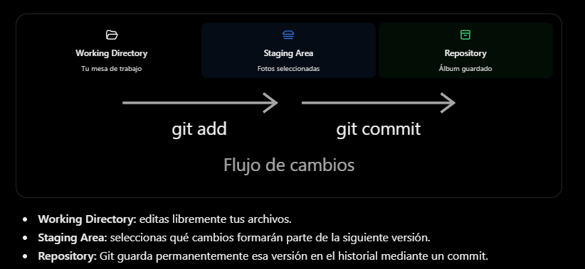

Git

Herramienta de control de versiones
Funciona en tu computadora
No requiere internet para crear commits

GitHub
Plataforma de alojamiento y colaboración
Funciona como servicio remoto
Permite compartir ese historial
Requiere conexión para sincronizar

Comprobar que tienes Git instalado

git --version

Verificar si tu aplicación ya tiene Git

git status

Resultado esperado: 
On branch main
nothing to commit, working tree clean

Zonas de git

El archivo .gitignore

Hay que validar que se tiene el archivo .gitignore para que no se suba nada adicional al repositorio

Conocer el estado del proyecto

git status

Archivos que han cambiado

git diff

Agregar todo al staging

git add .
